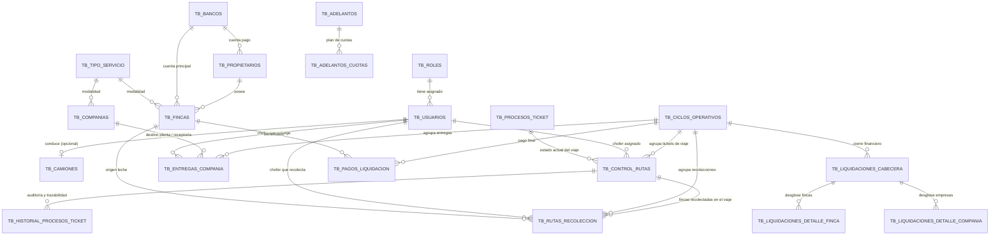
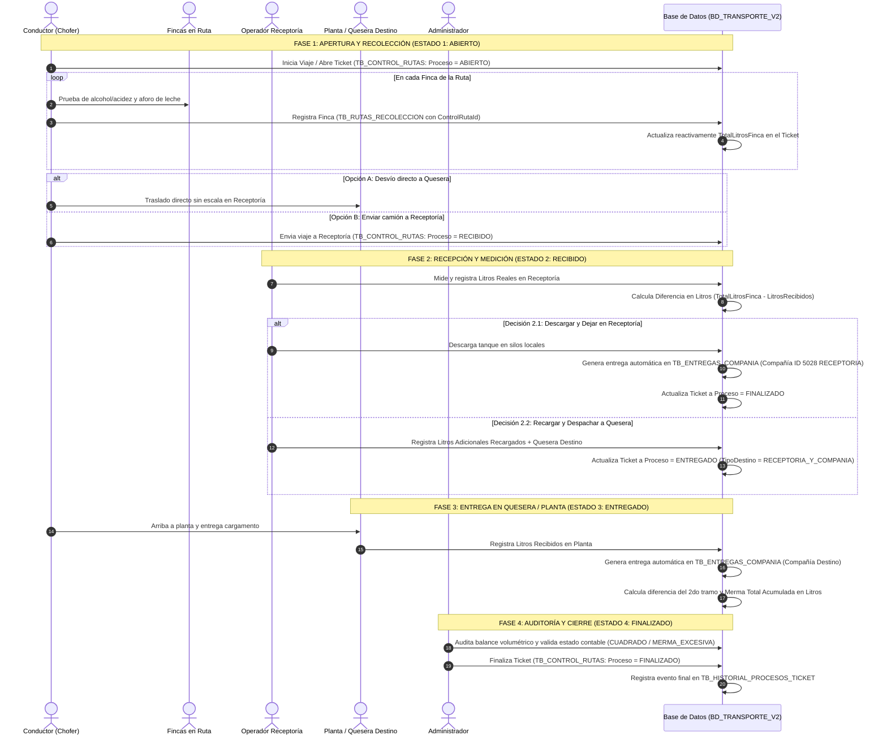

# 📊 Documentación de Base de Datos y Proceso Logístico de Recolección de Leche

> **Sistema:** Transporte de Leche, Control de Viajes y Gestión de Fincas  
> **Motor de Base de Datos:** Microsoft SQL Server  
> **Bases de Datos:** `BD_TRANSPORTE_V2` (Ambiente de Evolución Logística) / `BD_TRANSPORTE` (Versión Estable)  
> **Última Actualización:** Septiembre 2026 (Flujo Logístico de Tickets y Viajes AGENTS_2)  

---

## 📑 Tabla de Contenidos
1. [Arquitectura General y Modelo Entidad-Relación](#1-arquitectura-general-y-modelo-entidad-relación)
2. [Catálogo Completo de Tablas](#2-catálogo-completo-de-tablas)
3. [Diccionario de Datos Detallado (Columnas y Tipos)](#3-diccionario-de-datos-detallado)
4. [Relaciones y Llaves Foráneas (Foreign Keys)](#4-relaciones-y-llaves-foráneas)
5. [Vistas del Sistema](#5-vistas-del-sistema)
6. [Flujo Operativo: Ciclo de Vida del Ticket y Recolección de Leche](#6-flujo-operativo-ciclo-de-vida-del-ticket-y-recolección-de-leche)

---

## 1. Arquitectura General y Modelo Entidad-Relación

El sistema está organizado modularmente en 7 áreas clave:
- **Seguridad y Accesos:** Usuarios, roles, módulos y permisos granulares.
- **Flota y Transporte:** Camiones cisterna con compartimientos independientes y asignación de conductores.
- **Productores y Fincas:** Propietarios, fincas con coordenadas/rutas y cuentas bancarias asociadas.
- **Plantas Receptoras y Queseras:** Compañías lácteas compradoras y centro de acopio / Receptoría física (`ID = 5028`).
- **Operaciones Logísticas de Viajes / Tickets:** Control y trazabilidad de viajes (`TB_CONTROL_RUTAS`), catálogo de estados del ciclo de vida (`TB_PROCESOS_TICKET`) y bitácora inmutable de eventos (`TB_HISTORIAL_PROCESOS_TICKET`).
- **Operaciones de Campo:** Ciclos operativos (semanas), rutas de recolección diaria en fincas y entregas en planta.
- **Finanzas y Liquidación:** Liquidación cabecera/detalle, conciliación de mermas, adelantos de dinero con cuotas semanales, deducciones, historial de tasas BCV y pagos bancarios.



---

## 2. Catálogo Completo de Tablas

| N° | Tabla | Módulo / Función | Total Columnas | Registros Actuales |
|:---:|:---|:---|:---:|:---:|
| 1 | **[TB_USUARIOS](#tb_usuarios)** | Usuarios del sistema, contraseñas hash (BCrypt), roles y contacto | 13 | Activo |
| 2 | **[TB_ROLES](#tb_roles)** | Roles del sistema (ADMIN, CHOFER, RECEPTOR, etc.) | 6 | Activo |
| 3 | **[TB_MODULOS](#tb_modulos)** | Módulos del menú y áreas funcionales | 6 | Activo |
| 4 | **[TB_PERMISOS](#tb_permisos)** | Acciones y permisos por módulo (Crear, Editar, Ver, Eliminar) | 7 | Activo |
| 5 | **[TB_ROL_PERMISOS](#tb_rol_permisos)** | Tabla intermedia de permisos asignados a cada rol | 5 | Activo |
| 6 | **[TB_CAMIONES](#tb_camiones)** | Flota de vehículos cisterna, placas, compartimientos y litros | 10 | Activo |
| 7 | **[TB_PROPIETARIOS](#tb_propietarios)** | Productores / ganaderos dueños de fincas y titulares de pago | 13 | Activo |
| 8 | **[TB_FINCAS](#tb_fincas)** | Fincas productoras, precios por litro y asignación de propietario | 17 | Activo |
| 9 | **[TB_FINCA_CUENTAS_BANCARIAS](#tb_finca_cuentas_bancarias)** | Múltiples cuentas bancarias asociadas a fincas para dispersión | 9 | Activo |
| 10 | **[TB_COMPANIAS](#tb_companias)** | Plantas receptoras / industrias lácteas compradoras | 10 | Activo |
| 11 | **[TB_TIPO_SERVICIO](#tb_tipo_servicio)** | Catálogo de modalidades: RUTA (acopio) y TRANSPORTE (flete) | 4 | Activo |
| 12 | **[TB_BANCOS](#tb_bancos)** | Catálogo de entidades bancarias nacionales con código oficial | 4 | Activo |
| 13 | **[TB_CICLOS_OPERATIVOS](#tb_ciclos_operativos)** | Semanas operativas del año (S01..S52) para corte y liquidación | 9 | Activo |
| 14 | **[TB_RUTAS_RECOLECCION](#tb_rutas_recoleccion)** | Registro de litros recolectados en finca por viaje y chofer | 16 | Activo |
| 15 | **[TB_ENTREGAS_COMPANIA](#tb_entregas_compania)** | Registro de descargas físicas de leche entregadas en planta o receptoría | 13 | Activo |
| 16 | **[TB_LIQUIDACIONES_CABECERA](#tb_liquidaciones_cabecera)** | Consolidado semanal de liquidación en USD y Bolívares (VES) | 16 | Activo |
| 17 | **[TB_LIQUIDACIONES_DETALLE_FINCA](#tb_liquidaciones_detalle_finca)** | Desglose por finca: litros, precio, bruto, adelantos y neto a pagar | 11 | Activo |
| 18 | **[TB_LIQUIDACIONES_DETALLE_COMPANIA](#tb_liquidaciones_detalle_compania)** | Desglose por compañía: litros recibidos, precio venta y total a cobrar | 12 | Activo |
| 19 | **[TB_DEDUCCIONES_FINCA_CICLO](#tb_deducciones_finca_ciclo)** | Deducciones puntuales por ciclo (fletes especiales, insumos) | 6 | Activo |
| 20 | **[TB_PAGOS_LIQUIDACION](#tb_pagos_liquidacion)** | Recibos finales de pago bancario a cada finca/productor | 31 | Activo |
| 21 | **[TB_ADELANTOS](#tb_adelantos)** | Préstamos / adelantos de dinero otorgados a productores | 16 | Activo |
| 22 | **[TB_ADELANTOS_CUOTAS](#tb_adelantos_cuotas)** | Cuotas semanales programadas para amortización de adelantos | 14 | Activo |
| 23 | **[TB_HISTORIAL_BCV](#tb_historial_bcv)** | Tasas oficiales históricas del Banco Central de Venezuela | 7 | Activo |
| 24 | **[TB_HISTORIAL_LOG_PRECIOS](#tb_historial_log_precios)** | Auditoría de cambios masivos o individuales en precios de leche | 11 | Activo |
| 25 | **[TB_PROCESOS_TICKET](#tb_procesos_ticket)** | Catálogo maestro de estados logísticos (Abierto, Recibido, Entregado, Finalizado) | 9 | Activo |
| 26 | **[TB_CONTROL_RUTAS](#tb_control_rutas)** | Tickets de viaje logístico, trazabilidad de leche, recargas y balances volumétricos | 26 | Activo |
| 27 | **[TB_HISTORIAL_PROCESOS_TICKET](#tb_historial_procesos_ticket)** | Bitácora inmutable de transiciones de estado, operador y observaciones | 6 | Activo |

---

## 3. Diccionario de Datos Detallado

### `TB_USUARIOS`
Usuarios registrados para acceso a la aplicación web / API y conductores de la flota.
| Columna | Tipo | Nulo | Llave | Descripción |
|:---|:---|:---:|:---:|:---|
| `Id` | `int` | **NOT NULL** | 🔑 PK | Identificador único autoincremental |
| `Username` | `nvarchar(50)` | **NOT NULL** | | Nombre de usuario para autenticación |
| `PasswordHash` | `nvarchar(255)` | **NOT NULL** | | Hash de contraseña con salt (BCrypt) |
| `NombreCompleto` | `nvarchar(100)` | **NOT NULL** | | Nombre y apellido del usuario |
| `Rol` | `nvarchar(30)` | **NOT NULL** | | Nombre del rol (ADMIN, CHOFER, RECEPTOR) |
| `RolId` | `int` | NULL | FK | Referencia a `TB_ROLES(Id)` |
| `Cedula` | `nvarchar(20)` | NULL | | Cédula de identidad (V- / E-) |
| `Telefono` | `nvarchar(30)` | NULL | | Número telefónico de contacto |
| `VehiculoPlaca` | `nvarchar(20)` | NULL | | Placa de camión sincronizada |
| `CapacidadTanqueLitros` | `int` | NULL | | Capacidad en litros sincronizada |
| `Activo` | `bit` | **NOT NULL** | | Estado (1 = Activo, 0 = Inactivo) |
| `IsDeleted` | `bit` | **NOT NULL** | | Soft delete (1 = Borrado lógico) |
| `CreatedAt` | `datetime2` | **NOT NULL** | | Fecha y hora de creación |

---

### `TB_CAMIONES`
Catálogo independiente de la flota de camiones cisterna para transporte de leche cruda.
| Columna | Tipo | Nulo | Llave | Descripción |
|:---|:---|:---:|:---:|:---|
| `Id` | `int` | **NOT NULL** | 🔑 PK | Identificador único del camión |
| `UsuarioId` | `int` | NULL | FK | Conductor asignado en `TB_USUARIOS(Id)` (NULL = Disponible en flota) |
| `Placa` | `nvarchar(20)` | **NOT NULL** | | Placa de circulación del vehículo (Única) |
| `Compartimientos` | `int` | **NOT NULL** | | Cantidad de compartimientos independientes (1 a 4) |
| `CapacidadLitros` | `decimal(12,2)` | **NOT NULL** | | Capacidad volumétrica total en litros |
| `MarcaModelo` | `nvarchar(100)` | NULL | | Marca, modelo o año del camión (ej. Mack Granite) |
| `Observaciones` | `nvarchar(250)` | NULL | | Notas de mantenimiento, chofer alterno, etc. |
| `Activo` | `bit` | **NOT NULL** | | Estado operativo (1 = Operativo, 0 = Taller/Baja) |
| `IsDeleted` | `bit` | **NOT NULL** | | Eliminación lógica del registro |
| `CreatedAt` | `datetime2` | **NOT NULL** | | Fecha de alta en la flota |

---

### `TB_PROPIETARIOS`
Productores y ganaderos dueños de las fincas y titulares de los pagos.
| Columna | Tipo | Nulo | Llave | Descripción |
|:---|:---|:---:|:---:|:---|
| `Id` | `int` | **NOT NULL** | 🔑 PK | Identificador del propietario |
| `Nombre` | `nvarchar(150)` | **NOT NULL** | | Razón social o nombre completo del productor |
| `CedulaRIF` | `nvarchar(50)` | NULL | | Documento de identidad fiscal |
| `Telefono` | `nvarchar(50)` | NULL | | Teléfono de contacto |
| `Email` | `nvarchar(100)` | NULL | | Correo electrónico |
| `BancoId` | `int` | NULL | FK | Banco preferente en `TB_BANCOS(Id)` |
| `NumeroCuenta` | `nvarchar(50)` | NULL | | Número de cuenta de 20 dígitos |
| `Observacion` | `nvarchar(MAX)` | NULL | | Notas adicionales del productor |
| `Estado` | `nvarchar(20)` | NULL | | Estado del productor (Activo/Inactivo) |
| `CreatedAt` | `datetime` | NULL | | Fecha de creación |
| `CreatedBy` | `int` | NULL | | Usuario creador |
| `ModifiedAt` | `datetime` | NULL | | Fecha de última modificación |
| `ModifiedBy` | `int` | NULL | | Usuario que modificó |

---

### `TB_FINCAS`
Unidades de producción lechera donde se realiza el acopio diario.
| Columna | Tipo | Nulo | Llave | Descripción |
|:---|:---|:---:|:---:|:---|
| `Id` | `int` | **NOT NULL** | 🔑 PK | Identificador de la finca |
| `Codigo` | `nvarchar(20)` | NULL | | Código nemotécnico de la finca |
| `Nombre` | `nvarchar(100)` | **NOT NULL** | | Nombre de la finca / hato |
| `Propietario` | `nvarchar(100)` | **NOT NULL** | | Nombre impreso del titular |
| `PropietarioId` | `int` | NULL | FK | Vínculo a `TB_PROPIETARIOS(Id)` |
| `CedulaRIF` | `nvarchar(20)` | NULL | | Documento de identidad |
| `Telefono` | `nvarchar(30)` | NULL | | Teléfono de contacto |
| `BancoId` | `int` | NULL | FK | Banco asignado en `TB_BANCOS(Id)` |
| `NumeroCuenta` | `nvarchar(20)` | NULL | | Número de cuenta bancaria |
| `PrecioLitroUSD` | `decimal(10,4)` | **NOT NULL** | | Precio base pactado por litro en USD |
| `PrecioLitroAcidaUSD` | `decimal(10,4)` | **NOT NULL** | | Precio reducido por litro de leche ácida en USD |
| `TipoServicioId` | `int` | NULL | FK | Modalidad en `TB_TIPO_SERVICIO(Id)` |
| `OtrasDeduccionesBs` | `decimal(10,2)` | NULL | | Deducción fija recurrente en Bolívares |
| `ConceptoDeducciones` | `nvarchar(255)` | NULL | | Descripción de la deducción fija |
| `Activo` | `bit` | **NOT NULL** | | Finca activa en el acopio |
| `IsDeleted` | `bit` | **NOT NULL** | | Borrado lógico |
| `CreatedAt` | `datetime2` | **NOT NULL** | | Fecha de registro |

---

### `TB_COMPANIAS`
Compañías procesadoras e industrias receptoras de la leche (plantas / queseras).
| Columna | Tipo | Nulo | Llave | Descripción |
|:---|:---|:---:|:---:|:---|
| `Id` | `int` | **NOT NULL** | 🔑 PK | Identificador de la compañía receptora |
| `Nombre` | `nvarchar(100)` | **NOT NULL** | | Nombre de la planta procesadora |
| `Encargado` | `nvarchar(100)` | NULL | | Persona responsable en planta |
| `Telefono` | `nvarchar(30)` | NULL | | Teléfono de la planta |
| `Direccion` | `nvarchar(200)` | NULL | | Ubicación física |
| `PrecioCompraLitroUSD` | `decimal(10,4)` | **NOT NULL** | | Precio al que la planta paga el litro en USD |
| `TipoServicioId` | `int` | NULL | FK | Modalidad: 1=RUTA, 2=TRANSPORTE |
| `Activo` | `bit` | **NOT NULL** | | Estado operativo |
| `IsDeleted` | `bit` | **NOT NULL** | | Borrado lógico |
| `CreatedAt` | `datetime2` | **NOT NULL** | | Fecha de registro |

---

### `TB_CICLOS_OPERATIVOS`
Semanas operativas del año (Semanas 1 a 52) sobre las cuales se realizan los cortes.
| Columna | Tipo | Nulo | Llave | Descripción |
|:---|:---|:---:|:---:|:---|
| `Id` | `int` | **NOT NULL** | 🔑 PK | Identificador del ciclo |
| `Codigo` | `nvarchar(100)` | **NOT NULL** | | Código de semana (ej. SEMANA-36-2026) |
| `FechaInicio` | `date` | **NOT NULL** | | Fecha de inicio del ciclo (Lunes) |
| `FechaFin` | `date` | **NOT NULL** | | Fecha de fin del ciclo (Domingo) |
| `Estado` | `nvarchar(20)` | **NOT NULL** | | ABIERTO / CERRADO / LIQUIDADO |
| `FechaCierre` | `datetime2` | NULL | | Fecha y hora en que se cerró el ciclo |
| `CerradoPor` | `int` | NULL | FK | Usuario que ejecutó el cierre (`TB_USUARIOS`) |
| `Observaciones` | `nvarchar(500)` | NULL | | Observaciones del cierre |
| `CreatedAt` | `datetime2` | **NOT NULL** | | Fecha de creación del ciclo |

---

### `TB_RUTAS_RECOLECCION`
Registro transaccional diario de la leche recolectada en cada finca.
| Columna | Tipo | Nulo | Llave | Descripción |
|:---|:---|:---:|:---:|:---|
| `Id` | `bigint` | **NOT NULL** | 🔑 PK | Identificador de la recolección |
| `CicloId` | `int` | **NOT NULL** | FK | Semana operativa (`TB_CICLOS_OPERATIVOS`) |
| `Fecha` | `date` | **NOT NULL** | | Fecha del viaje de recolección |
| `FincaId` | `int` | **NOT NULL** | FK | Finca recolectada (`TB_FINCAS`) |
| `UsuarioId` | `int` | **NOT NULL** | FK | Chofer que recolectó (`TB_USUARIOS`) |
| `Litros` | `int` | **NOT NULL** | | Volumen en litros recolectados |
| `EsAcida` | `bit` | **NOT NULL** | | 0 = Normal/Buena, 1 = Ácida (calidad comprometida) |
| `PrecioLitroUSDAplicado` | `decimal(18,4)` | NULL | | Precio pactado al momento del viaje |
| `TasaDolarBsAplicada` | `decimal(18,4)` | NULL | | Tasa BCV aplicada a la fecha |
| `Observacion` | `nvarchar(500)` | NULL | | Novedades en finca (temperatura, acidez) |
| `UuidLocal` | `varchar(50)` | NULL | | UUID para sincronización offline PWA |
| `ControlRutaId` | `bigint` | NULL | FK | Vínculo al ticket de viaje logístico (`TB_CONTROL_RUTAS`) |
| `CreatedAt` | `datetime2` | **NOT NULL** | | Creación del registro |
| `CreatedBy` | `int` | NULL | FK | Creado por |
| `ModifiedAt` | `datetime2` | NULL | | Modificado en |
| `ModifiedBy` | `int` | NULL | FK | Modificado por |

---

### `TB_ENTREGAS_COMPANIA`
Registro de descargas de leche efectuadas en las compañías lácteas.
| Columna | Tipo | Nulo | Llave | Descripción |
|:---|:---|:---:|:---:|:---|
| `Id` | `bigint` | **NOT NULL** | 🔑 PK | Identificador de la entrega en planta |
| `CicloId` | `int` | **NOT NULL** | FK | Semana operativa (`TB_CICLOS_OPERATIVOS`) |
| `Fecha` | `date` | **NOT NULL** | | Fecha de entrega en planta |
| `CompaniaId` | `int` | **NOT NULL** | FK | Planta que recibe (`TB_COMPANIAS`) |
| `UsuarioId` | `int` | **NOT NULL** | FK | Chofer que descargó (`TB_USUARIOS`) |
| `Litros` | `int` | **NOT NULL** | | Litros netos recibidos y aforados |
| `PrecioVentaUSD` | `decimal(18,4)` | NULL | | Precio de venta por litro cobrado a la planta |
| `TasaDolarBsAplicada` | `decimal(18,4)` | NULL | | Tasa de cambio BCV oficial |
| `Observacion` | `nvarchar(500)` | NULL | | Notas de laboratorio / ticket de pesaje |
| `CreatedAt` | `datetime2` | **NOT NULL** | | Fecha de registro |
| `CreatedBy` | `int` | NULL | FK | Creado por |
| `ModifiedAt` | `datetime2` | NULL | | Modificado en |
| `ModifiedBy` | `int` | NULL | FK | Modificado por |

---

### `TB_LIQUIDACIONES_CABECERA`
Liquidación financiera global de la semana operativa.
| Columna | Tipo | Nulo | Llave | Descripción |
|:---|:---|:---:|:---:|:---|
| `Id` | `int` | **NOT NULL** | 🔑 PK | Identificador de la liquidación |
| `CicloId` | `int` | **NOT NULL** | FK | Semana operativa liquidada |
| `FechaLiquidacion` | `datetime2` | **NOT NULL** | | Fecha en que se liquidó |
| `TotalLitrosGeneral` | `int` | **NOT NULL** | | Litros totales liquidados a fincas |
| `TotalMontoUSD` | `decimal(18,2)` | **NOT NULL** | | Monto bruto a pagar en USD |
| `TotalBrutoBs` | `decimal(18,2)` | **NOT NULL** | | Monto bruto a pagar en Bolívares (VES) |
| `TotalAdelantosBs` | `decimal(18,2)` | **NOT NULL** | | Total amortizado de préstamos en Bs |
| `TotalNetoAPagarBs` | `decimal(18,2)` | **NOT NULL** | | Total neto desembolsado a productores |
| `TasaBcvLiquidacion` | `decimal(18,4)` | NULL | | Tasa oficial BCV utilizada |
| `TotalLitrosCobroGeneral`| `int` | NULL | | Litros totales cobrados a compañías |
| `TotalMontoCobroUSD` | `decimal(18,2)` | NULL | | Total cobro a compañías en USD |
| `TotalBrutoCobroBs` | `decimal(18,2)` | NULL | | Total cobro a compañías en Bs |
| `TotalAdelantosCobroBs` | `decimal(18,2)` | NULL | | Descuentos aplicados a compañías |
| `TotalNetoACobrarBs` | `decimal(18,2)` | NULL | | Neto final facturado a compañías |
| `ProcesadoPor` | `int` | **NOT NULL** | FK | Usuario responsable de la liquidación |
| `Estado` | `nvarchar(20)` | **NOT NULL** | | PROCESADA / PAGADA / ANULADA |

---

### `TB_LIQUIDACIONES_DETALLE_FINCA`
Desglose del pago correspondiente a cada finca en la liquidación semanal.
| Columna | Tipo | Nulo | Llave | Descripción |
|:---|:---|:---:|:---:|:---|
| `Id` | `bigint` | **NOT NULL** | 🔑 PK | Identificador del detalle |
| `LiquidacionId` | `int` | **NOT NULL** | FK | Cabecera (`TB_LIQUIDACIONES_CABECERA`) |
| `FincaId` | `int` | **NOT NULL** | FK | Finca acreedora (`TB_FINCAS`) |
| `TotalLitros` | `int` | **NOT NULL** | | Litros totales entregados en la semana |
| `TotalMontoUSD` | `decimal(18,2)` | **NOT NULL** | | Bruto en dólares |
| `TotalBrutoBs` | `decimal(18,2)` | **NOT NULL** | | Bruto en bolívares |
| `TotalAdelantosBs` | `decimal(18,2)` | **NOT NULL** | | Cuota de amortización descontada |
| `NetoPagarBs` | `decimal(18,2)` | **NOT NULL** | | Importe líquido a pagar |
| `BancoNombre` | `nvarchar(100)` | NULL | | Banco de la cuenta destino |
| `NumeroCuenta` | `nvarchar(20)` | NULL | | Número de cuenta de pago |
| `EstadoPago` | `nvarchar(20)` | **NOT NULL** | | PENDIENTE / PAGADO / RECHAZADO |

---

### `TB_LIQUIDACIONES_DETALLE_COMPANIA`
Desglose del cobro facturado a cada planta procesadora por la leche entregada.
| Columna | Tipo | Nulo | Llave | Descripción |
|:---|:---|:---:|:---:|:---|
| `Id` | `bigint` | **NOT NULL** | 🔑 PK | Identificador del cobro |
| `LiquidacionId` | `int` | **NOT NULL** | FK | Cabecera (`TB_LIQUIDACIONES_CABECERA`) |
| `CompaniaId` | `int` | **NOT NULL** | FK | Compañía deudora (`TB_COMPANIAS`) |
| `TotalLitros` | `int` | **NOT NULL** | | Litros descargados en la planta |
| `PrecioLitroUSD` | `decimal(18,4)` | **NOT NULL** | | Precio por litro de venta aplicado |
| `TotalMontoUSD` | `decimal(18,2)` | **NOT NULL** | | Subtotal en USD |
| `TotalBrutoBs` | `decimal(18,2)` | **NOT NULL** | | Subtotal en Bolívares |
| `TotalAdelantosBs` | `decimal(18,2)` | NULL | | Deducciones o anticipos |
| `NetoCobrarBs` | `decimal(18,2)` | **NOT NULL** | | Monto final a cobrar a la planta |
| `EstadoCobro` | `nvarchar(50)` | NULL | | PENDIENTE / COBRADO |
| `Observacion` | `nvarchar(250)` | NULL | | Notas de conciliación de cobro |
| `CreatedAt` | `datetime2` | NULL | | Fecha de creación |

---

### `TB_ADELANTOS` y `TB_ADELANTOS_CUOTAS`
Control y amortización de anticipos y préstamos a productores.
* **`TB_ADELANTOS`:**
  * `MontoTotalUSD`: Monto principal del préstamo.
  * `NumeroCuotas`: Cantidad de semanas pactadas para el pago.
  * `MontoCuotaUSD`: Monto semanal a deducir en liquidación.
  * `MontoPagadoUSD` / `MontoPendienteUSD`: Saldo vivo del préstamo.
  * `Estado`: ACTIVO / PAGADO / ANULADO.
* **`TB_ADELANTOS_CUOTAS`:**
  * `AdelantoId`: Vínculo al préstamo padre.
  * `NumeroCuota`: Cuota correlativa (ej. Cuota 1 de 4).
  * `SemanaOperativaId`: Semana en la cual se deduce la cuota.
  * `MontoCobradoUSD` / `MontoCobradoBs`: Monto efectivamente descontado.
  * `Estado`: PENDIENTE / COBRADO / POSPUESTO.

---

### `TB_PAGOS_LIQUIDACION`
Recibo integral con desglose contable de la orden de pago emitida al productor.
Contiene 31 campos para trazabilidad bancaria completa:
* Finca, Propietario, Cédula/RIF, Banco y Número de Cuenta.
* Litros Buenos vs. Litros Ácidos con sus respectivos precios unitarios.
* Total USD, Tasa BCV aplicada y Total Bruto Bs.
* Descuento de Adelantos (USD y Bs) y detalle de cuotas amortizadas.
* Otras deducciones y Total Neto Bs a transferir.
* Estado de pago y fecha de ejecución de la transferencia.

---

### `TB_PROCESOS_TICKET`
Catálogo maestro de estados logísticos para el ciclo de vida del Ticket de Transporte.
| Columna | Tipo | Nulo | Llave | Descripción |
|:---|:---|:---:|:---:|:---|
| `Id` | `int` | **NOT NULL** | 🔑 PK | Identificador del estado (1: ABIERTO, 2: RECIBIDO, 3: ENTREGADO, 4: FINALIZADO) |
| `Codigo` | `varchar(30)` | **NOT NULL** | | Código mnemotécnico único (ABIERTO, RECIBIDO, ENTREGADO, FINALIZADO) |
| `Nombre` | `nvarchar(100)` | **NOT NULL** | | Nombre descriptivo del estado |
| `Descripcion` | `nvarchar(300)` | NULL | | Explicación del alcance operativo del estado |
| `Orden` | `tinyint` | **NOT NULL** | | Secuencia cronológica del flujo logístico |
| `Color` | `varchar(20)` | NULL | | Código de color HEX para badges en UI |
| `Icono` | `varchar(60)` | NULL | | Clase de FontAwesome para interfaz visual |
| `Activo` | `bit` | **NOT NULL** | | 1 = Habilitado, 0 = Deshabilitado |
| `CreatedAt` | `datetime2` | **NOT NULL** | | Fecha de creación del estado |

---

### `TB_CONTROL_RUTAS`
Registro de Tickets de Viaje Logístico. Centraliza la trazabilidad del camión cisterna, desde la recolección en fincas, pasando por el pesaje en receptoría (o desvío directo) y eventual recarga, hasta la entrega final y cuadre en litros.
| Columna | Tipo | Nulo | Llave | Descripción |
|:---|:---|:---:|:---:|:---|
| `Id` | `bigint` | **NOT NULL** | 🔑 PK | Número único de Ticket de viaje |
| `Fecha` | `date` | **NOT NULL** | | Fecha operativa de la recolección |
| `UsuarioId` | `int` | **NOT NULL** | FK | Conductor asignado al viaje (`TB_USUARIOS`) |
| `CicloId` | `int` | NULL | FK | Semana operativa a la que pertenece (`TB_CICLOS_OPERATIVOS`) |
| `TotalLitrosFinca` | `int` | **NOT NULL** | | Litros totales cargados en campo (suma reactiva de `TB_RUTAS_RECOLECCION`) |
| `TotalLitrosReceptoria` | `int` | **NOT NULL** | | Litros medidos y registrados al arribar a receptoría o planta |
| `DiferenciaLitros` | `int` | **NOT NULL** | | Diferencia volumétrica física (`TotalLitrosFinca - TotalLitrosReceptoria`) |
| `PorcentajeMerma` | `decimal(5,2)` | **NOT NULL** | | Porcentaje de variación volumétrica física |
| `Estado` | `varchar(50)` | **NOT NULL** | | Estado contable del viaje (ABIERTO, PENDIENTE, CUADRADO, MERMA_EXCESIVA) |
| `ProcesoActualId` | `int` | NULL | FK | Estado logístico actual (`TB_PROCESOS_TICKET`: 1=Abierto, 2=Recibido, 3=Entregado, 4=Finalizado) |
| `TipoDestino` | `varchar(30)` | NULL | | Modalidad logística (`RECEPTORIA`, `COMPANIA_DIRECTA`, `RECEPTORIA_Y_COMPANIA`) |
| `LitrosRecibidosReceptoria`| `int` | NULL | | Litros reales aforados en Receptoría física |
| `DiferenciaReceptoria` | `int` | NULL | | Diferencia en litros del 1er tramo (`TotalLitrosFinca - LitrosRecibidosReceptoria`) |
| `LitrosCargadosAdicional` | `int` | **NOT NULL** | | Litros adicionales recargados en el camión en Receptoría para despacho |
| `CompaniaDestinoId` | `int` | NULL | FK | Quesera o industria láctea destino (`TB_COMPANIAS`) |
| `LitrosEntregadosCompania` | `int` | NULL | | Litros finales entregados y recibidos en la quesera/planta |
| `DiferenciaCompania` | `int` | NULL | | Diferencia en litros del 2do tramo entre receptoría y planta |
| `MermaTotalLitros` | `int` | NULL | | Merma física neta total acumulada en litros durante todo el viaje |
| `FechaLlegadaReceptoria` | `datetime2` | NULL | | Timestamp exacto de llegada y pesaje en Receptoría |
| `FechaEntregaCompania` | `datetime2` | NULL | | Timestamp exacto de descarga en la quesera/planta |
| `CerradoPor` | `int` | NULL | FK | Administrador que ejecutó la auditoría y cierre del viaje (`TB_USUARIOS`) |
| `Observacion` | `nvarchar(500)` | NULL | | Notas de ruta, precintos o novedades del viaje |
| `CreatedAt` | `datetime2` | **NOT NULL** | | Fecha y hora de apertura del ticket |
| `CreatedBy` | `int` | NULL | FK | Creado por |
| `ModifiedAt` | `datetime2` | NULL | | Última modificación |
| `ModifiedBy` | `int` | NULL | FK | Modificado por |

---

### `TB_HISTORIAL_PROCESOS_TICKET`
Bitácora inmutable de auditoría para cada transición de estado en la vida de un ticket logístico.
| Columna | Tipo | Nulo | Llave | Descripción |
|:---|:---|:---:|:---:|:---|
| `Id` | `bigint` | **NOT NULL** | 🔑 PK | Identificador correlativo del evento |
| `ControlRutaId` | `bigint` | **NOT NULL** | FK | Ticket de viaje asociado (`TB_CONTROL_RUTAS`) |
| `ProcesoId` | `int` | **NOT NULL** | FK | Estado al que transicionó (`TB_PROCESOS_TICKET`) |
| `FechaCambio` | `datetime2` | **NOT NULL** | | Fecha y hora exacta de la transición |
| `CambiadoPor` | `int` | **NOT NULL** | FK | Usuario responsable de la acción (`TB_USUARIOS`) |
| `Observacion` | `nvarchar(300)` | NULL | | Justificación técnica, pesaje o notas operativas |

---

## 4. Relaciones y Llaves Foráneas

```
TB_CONTROL_RUTAS.UsuarioId                --> TB_USUARIOS.Id (FK_ControlRutas_Usuarios)
TB_CONTROL_RUTAS.CicloId                  --> TB_CICLOS_OPERATIVOS.Id (FK_ControlRutas_Ciclos)
TB_CONTROL_RUTAS.ProcesoActualId          --> TB_PROCESOS_TICKET.Id (FK_ControlRutas_ProcesoActual)
TB_CONTROL_RUTAS.CompaniaDestinoId        --> TB_COMPANIAS.Id (FK_ControlRutas_CompaniaDestino)
TB_CONTROL_RUTAS.CerradoPor               --> TB_USUARIOS.Id (FK_ControlRutas_CerradoPor)
TB_HISTORIAL_PROCESOS_TICKET.ControlRutaId--> TB_CONTROL_RUTAS.Id (FK_Historial_ControlRuta)
TB_HISTORIAL_PROCESOS_TICKET.ProcesoId    --> TB_PROCESOS_TICKET.Id (FK_Historial_Procesos)
TB_HISTORIAL_PROCESOS_TICKET.CambiadoPor  --> TB_USUARIOS.Id (FK_Historial_Usuarios)
TB_RUTAS_RECOLECCION.ControlRutaId        --> TB_CONTROL_RUTAS.Id (FK_Rutas_ControlRuta)

TB_CAMIONES.UsuarioId                    --> TB_USUARIOS.Id (FK_Camiones_Usuarios)
TB_CICLOS_OPERATIVOS.CerradoPor          --> TB_USUARIOS.Id (FK__CiclosOpe__Cerra__5BE2A6F2)
TB_COMPANIAS.TipoServicioId              --> TB_TIPO_SERVICIO.Id (FK_Queseras_TiposServicio)
TB_FINCAS.BancoId                        --> TB_BANCOS.Id (FK__Fincas__BancoId__47DBAE45)
TB_FINCAS.PropietarioId                  --> TB_PROPIETARIOS.Id (FK_TB_FINCAS_PROPIETARIOS)
TB_FINCAS.TipoServicioId                 --> TB_TIPO_SERVICIO.Id (FK_Fincas_TiposServicio)
TB_PROPIETARIOS.BancoId                  --> TB_BANCOS.Id (FK_TB_PROPIETARIOS_BANCOS)

TB_RUTAS_RECOLECCION.CicloId             --> TB_CICLOS_OPERATIVOS.Id (FK__RutasReco__Ciclo__5FB337D6)
TB_RUTAS_RECOLECCION.FincaId             --> TB_FINCAS.Id (FK__RutasReco__Finca__60A75C0F)
TB_RUTAS_RECOLECCION.UsuarioId           --> TB_USUARIOS.Id (FK_Rutas_Usuarios)
TB_RUTAS_RECOLECCION.CreatedBy           --> TB_USUARIOS.Id (FK__RutasReco__Creat__6383C8BA)
TB_RUTAS_RECOLECCION.ModifiedBy          --> TB_USUARIOS.Id (FK__TB_RUTAS___Modif__2EDAF651)

TB_ENTREGAS_COMPANIA.CicloId             --> TB_CICLOS_OPERATIVOS.Id (FK__EntregasQ__Ciclo__66603565)
TB_ENTREGAS_COMPANIA.CompaniaId          --> TB_COMPANIAS.Id (FK__EntregasQ__Quese__6754599E)
TB_ENTREGAS_COMPANIA.UsuarioId           --> TB_USUARIOS.Id (FK_Entregas_Usuarios)
TB_ENTREGAS_COMPANIA.CreatedBy           --> TB_USUARIOS.Id (FK__EntregasQ__Creat__6B24EA82)
TB_ENTREGAS_COMPANIA.ModifiedBy          --> TB_USUARIOS.Id (FK__TB_ENTREG__Modif__2FCF1A8A)

TB_LIQUIDACIONES_CABECERA.CicloId        --> TB_CICLOS_OPERATIVOS.Id (FK__Liquidaci__Ciclo__76969D2E)
TB_LIQUIDACIONES_CABECERA.ProcesadoPor   --> TB_USUARIOS.Id (FK__Liquidaci__Proce__787EE5A0)
TB_LIQUIDACIONES_DETALLE_FINCA.LiquidacionId --> TB_LIQUIDACIONES_CABECERA.Id (FK__Liquidaci__Liqui__7C4F7684)
TB_LIQUIDACIONES_DETALLE_FINCA.FincaId       --> TB_FINCAS.Id (FK__Liquidaci__Finca__7D439ABD)
TB_LIQUIDACIONES_DETALLE_COMPANIA.LiquidacionId --> TB_LIQUIDACIONES_CABECERA.Id (FK_LiqDetCompania_Cabecera)

TB_ADELANTOS_CUOTAS.AdelantoId           --> TB_ADELANTOS.Id (FK_TB_ADELANTOS_CUOTAS_ADELANTO)
TB_PAGOS_LIQUIDACION.CicloId             --> TB_CICLOS_OPERATIVOS.Id (FK__TB_PAGOS___Ciclo__6FB49575)
TB_PAGOS_LIQUIDACION.FincaId             --> TB_FINCAS.Id (FK__TB_PAGOS___Finca__70A8B9AE)
TB_DEDUCCIONES_FINCA_CICLO.CicloId       --> TB_CICLOS_OPERATIVOS.Id (FK__TB_DEDUCC__Ciclo__681373AD)
TB_DEDUCCIONES_FINCA_CICLO.FincaId       --> TB_FINCAS.Id (FK__TB_DEDUCC__Finca__671F4F74)

TB_HISTORIAL_BCV.CreatedBy               --> TB_USUARIOS.Id (FK__TasasCamb__Creat__403A8C7D)
TB_PERMISOS.ModuloId                     --> TB_MODULOS.Id (FK__TB_PERMIS__Modul__17F790F9)
TB_ROL_PERMISOS.RolId                    --> TB_ROLES.Id (FK__TB_ROL_PE__RolId__1CBC4616)
TB_ROL_PERMISOS.PermisoId                --> TB_PERMISOS.Id (FK__TB_ROL_PE__Permi__1DB06A4F)
TB_USUARIOS.RolId                        --> TB_ROLES.Id (FK__TB_USUARI__RolId__208CD6FA)
```

---

## 5. Vistas del Sistema

### `VW_CUADRE_MERMAS_SEMANA`
Calcula en tiempo real la conciliación entre leche cargada en finca y leche recibida en planta por chofer y fecha:
* `CicloCodigo`
* `Fecha`
* `UsuarioId` / `NombreConductor`
* `LitrosRecolectados`
* `LitrosEntregados`
* `MermaLitros` (`LitrosRecolectados - LitrosEntregados`)
* `PorcentajeMerma`

### `VW_DETALLE_DIARIO_FINCA`
Permite auditar el movimiento diario por finca, precio aplicado y subtotal:
* `CicloId` / `CodigoCiclo` / `Fecha` / `DiaSemana`
* `FincaId` / `NombreFinca` / `Propietario` / `TipoServicio`
* `Litros` / `PrecioLitroUSDAplicado` / `TasaDolarBsAplicada`
* `SubtotalUSD` / `SubtotalBs`

---

## 6. Flujo Operativo: Ciclo de Vida del Ticket y Recolección de Leche

El sistema implementa un modelo de trazabilidad volumétrica integral a través del **Ticket de Viaje Logístico** (`TB_CONTROL_RUTAS`), estructurado en 4 fases oficiales gobernadas por `TB_PROCESOS_TICKET`.

### Diagrama de Secuencia del Ciclo de Vida del Ticket:



---

### Descripción Detallada de las 4 Fases Logísticas:

#### 1. Fase 1: `ABIERTO` (Chofer en Ruta)
* **Apertura del Ticket:** El conductor abre su ticket de viaje para el día en curso (`POST /api/control-rutas/iniciar-viaje`). Se inicializan sus litros en `0` y su estado en `1 | ABIERTO`.
* **Carga Continua de Fincas:** Durante la ruta, cada recolección en finca se registra en `TB_RUTAS_RECOLECCION` vinculada automáticamente al `ControlRutaId` del ticket activo.
* **Totalizador Dinámico:** El campo `TotalLitrosFinca` de `TB_CONTROL_RUTAS` se recalcula en tiempo real sumando los litros recolectados.
* **Opciones de Despacho:** Al terminar la ruta, el chofer decide:
  * **Enviar a Receptoría:** Transiciona el ticket a estado `2 | RECIBIDO`.
  * **Entregar Directo en Quesera:** Desvía el camión a una empresa compradora sin pasar por la receptoría física, transicionando a `3 | ENTREGADO`.

#### 2. Fase 2: `RECIBIDO` (En Receptoría Física)
* **Pesaje y Medición:** El operador de receptoría afora el camión cisterna ingresando los litros reales medidos (`LitrosRecibidosReceptoria`).
* **Diferencia de Ruta (1er Tramo):**
  $$\text{DiferenciaReceptoria} = \text{TotalLitrosFinca} - \text{LitrosRecibidosReceptoria}$$
  * Si $\text{Diferencia} = 0$: Cuadre exacto en ruta.
  * Si $\text{Diferencia} > 0$: Faltante físico de leche.
  * Si $\text{Diferencia} < 0$: Sobrante físico de leche.
* **Bifurcación Logística:**
  * **Caso A (Descarga en Receptoría):** Toda la leche se descarga en los silos de la estación. El viaje concluye operativamente aquí: se inserta automáticamente un registro en `TB_ENTREGAS_COMPANIA` para la Receptoría (`CompaniaId = 5028`) y el ticket pasa a estado `4 | FINALIZADO`.
  * **Caso B (Recarga y Despacho a Quesera):** Se decide transferir leche a una industria láctea externa. Se registran los `LitrosCargadosAdicional` del silo al camión y se selecciona la `CompaniaDestinoId`. El ticket avanza a estado `3 | ENTREGADO`.

#### 3. Fase 3: `ENTREGADO` (Compañía / Quesera Destino)
* **Descarga en Planta:** El camión arriba a la empresa compradora y descarga. Se registran los `LitrosEntregadosCompania`.
* **Inserción en `TB_ENTREGAS_COMPANIA`:** Se crea automáticamente el registro oficial de entrega asociado a la compañía receptora con los litros descargados y notas de pesaje.
* **Consolidación de Mermas Físicas:**
  $$\text{DiferenciaCompania} = (\text{LitrosRecibidosReceptoria} + \text{LitrosCargadosAdicional}) - \text{LitrosEntregadosCompania}$$
  $$\text{MermaTotalLitros} = \text{DiferenciaReceptoria} + \text{DiferenciaCompania}$$

#### 4. Fase 4: `FINALIZADO` (Auditoría y Cierre Administrativo)
* **Auditoría de Litros:** El administrador revisa el balance volumétrico completo en la bitácora (`/api/control-rutas`).
* **Estado Contable:**
  * `CUADRADO`: Si la merma total es igual a 0 litros.
  * `MERMA_EXCESIVA`: Si la merma supera el umbral de tolerancia física permitido.
  * `PENDIENTE`: Si existen observaciones pendientes de aclarar.
* **Cierre Inmutable:** Se registra el usuario auditor en `CerradoPor` y se inserta el evento de cierre en `TB_HISTORIAL_PROCESOS_TICKET`.

---

### 🔄 Semi-Proceso: Traspaso de Leche a Otro Chofer (Transferencia entre Tickets)

Cuando un conductor (ej. Chofer Origen) completa su recolección en finca pero por logística, avería mecánica o asignación de ruta no realiza la entrega a planta/receptoría, transfiere la leche a otro conductor (ej. Chofer Destino) para que este último asuma el volumen y complete los despachos.

#### Modos de Operación:
1. **Asignar a Ticket Existente:** Selecciona un viaje/ticket ya abierto en el sistema para el chofer destino.
2. **Crear Automáticamente Nuevo Ticket:** Genera un nuevo ticket en `TB_CONTROL_RUTAS` especificando la fecha y el conductor destino.

#### Impacto en Base de Datos y Trazabilidad:
* **Ticket de Origen (`TB_CONTROL_RUTAS`):**
  - Litros cargados son transferidos: `TipoDestino = 'TRASPASO_CHOFER'`.
  - El ticket de origen pasa a estado `4 | FINALIZADO` / `TRASPASADO`.
  - Se audita en `TB_HISTORIAL_PROCESOS_TICKET` indicando el ticket y chofer receptor.
* **Ticket de Destino (`TB_CONTROL_RUTAS`):**
  - Incrementa su volumen disponible mediante `LitrosCargadosAdicional += LitrosTraspaso`.
  - Recibe la trazabilidad en notas y auditoría (`TB_HISTORIAL_PROCESOS_TICKET` y `TB_LOG_MODIFICACIONES_CONTROL`).
  - El Chofer Destino puede proceder a entregar a Receptoría o a Quesera/Compañía con el consolidado total de litros.

---

### Reglas de Negocio Clave:

> [!IMPORTANT]
> **1. Trazabilidad FÍSICA en Litros:**
> El sistema no descuenta ni calcula penalizaciones monetarias por merma en dólares (USD) ni bolívares (VES). La trazabilidad y conciliación es **100% volumétrica en Litros físicos**.

> [!IMPORTANT]
> **2. Entradas y Salidas en `TB_ENTREGAS_COMPANIA`:**
> Toda la leche que entra a descargarse en Receptoría (Compañía ID `5028`) y toda la leche que sale a entregarse en queseras/plantas externas alimenta automáticamente la tabla `TB_ENTREGAS_COMPANIA`.

> [!IMPORTANT]
> **3. Inmutabilidad de Registros Históricos:**
> Ningún registro de recolección ni de entregas se elimina; el modelo opera mediante transiciones de estado y auditoría progresiva.
