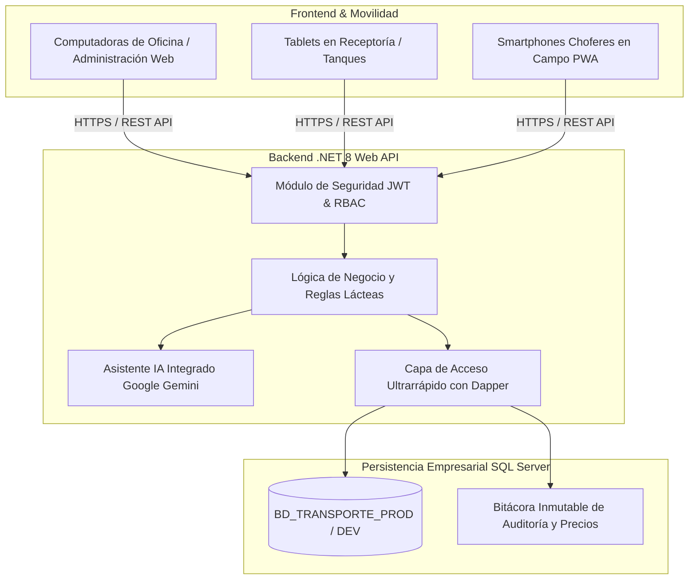

# 🥛 LACTOTRACK ERP — Sistema Integral de Logística, Acopio y Liquidación Láctea
### *La plataforma definitiva para la gestión de rutas de leche, control volumétrico de tanques y liquidación multimoneda a productores ganaderos.*

---

## 📌 1. Resumen Ejecutivo (Executive Summary)

En la industria agroindustrial láctea, el control logístico del transporte de leche cruda y la liquidación a productores ganaderos representan el **núcleo financiero y operativo más crítico y vulnerable de la empresa**. La dispersión geográfica de fincas, la variación de precios en entornos multimoneda (USD / Bs), las mermas no detectadas entre el camión cisterna y la planta receptora, y los cálculos manuales en hojas de cálculo suelen traducirse en **pérdidas económicas mensuales de entre un 3% y un 7% del volumen total transportado**.

**LactoTrack ERP (Sistema Transporte V2)** es una solución tecnológica de clase empresarial desarrollada específicamente para resolver los desafíos de:
- **Centros de Acopio y Receptorías Lácteas.**
- **Plantas Procesadoras de Lácteos y Queseras Industriales o Artesanales.**
- **Empresas de Transporte y Flete Cisterna de Leche Cruda.**
- **Asociaciones y Cooperativas de Productores Ganaderos.**

El sistema digitaliza y automatiza el ciclo completo: desde la recolección física en la finca con ticket digital, el balance volumétrico en tanques con cálculo de mermas en tiempo real, hasta la liquidación semanal automatizada, amortización de adelantos/préstamos y conciliación bimoneda con el Banco Central de Venezuela (BCV).

---

## 💎 2. Propuesta de Valor y Retorno de Inversión (ROI)

| Desafío Tradicional en el Sector | Solución de LactoTrack ERP | Impacto y Retorno de Inversión |
| :--- | :--- | :--- |
| **Pérdida por Mermas Invisibles:** Diferencia entre lo recolectado en fincas y lo recibido en receptoría o entregado a planta. | **Auditoría Volumétrica en Tiempo Real:** Comparativa inmediata ticket a ticket: `Litros Finca vs. Litros Receptoría vs. Entrega Planta`. Balance estricto de tanques de acopio. | **Recuperación directa de capital.** Cero litros extraviados sin responsable asignado. |
| **Cierres Semanales Lentos y Complejos:** Días enteros calculando recibos de pago en Excel, con errores humanos en deducciones y tasas de cambio. | **Pre-Liquidación Automatizada en 1 Clic:** Cálculos instantáneos de litros buenos, ácidos, precios por finca, adelantos y deducciones a tasa oficial. | **Reducción del tiempo de cierre administrativo de 3 días a menos de 10 minutos.** |
| **Complejidad Multimoneda (USD / Bs):** Precios pactados en dólares que deben pagarse en bolívares a la tasa oficial del día o semana. | **Motor Bimoneda Nativo con Historial BCV:** Conversión automática al dólar BCV oficial del día o tasa convenida, congelamiento de recibos ya pagados y actualización masiva de pendientes. | **Cero descalce cambiario.** Cuentas claras, transparentes y auditables para los productores. |
| **Financiamiento a Productores (Adelantos):** Descontrol en préstamos de dinero, combustible, medicamentos o sal, y olvido de cobro de cuotas. | **Módulo Financiero de Cuotas Semanales:** Descuento automático de cuotas en nómina de leche. Si la leche de la semana no cubre la cuota, calcula el saldo deudor restante de forma transparente. | **100% de cobranza efectiva de préstamos otorgados.** Cero créditos olvidados. |
| **Casos Complejos de Campo (Cortes de Semana):** Un productor entrega 500 L el día de corte y pide que 400 L entren en la semana actual y 100 L en la siguiente. | **Mecanismo Exclusivo de Diferimiento de Litros:** Desacopla el ciclo físico del ciclo financiero: el camión y el tanque conservan los 500 L físicos (cero falsa merma) y la nómina divide los litros exactamente como se acordó. | **Flexibilidad operativa real que ningún software genérico del mercado soporta.** |

---

## 🏗️ 3. Arquitectura Tecnológica del Sistema

Diseñado bajo estándares de ingeniería de software modernos para garantizar **alta disponibilidad, velocidad instantánea (sub-segundo) y tolerancia a fallos**:

### Especificaciones Técnicas
- **Backend:** C# / .NET 8.0 Web API RESTful de alto rendimiento.
- **Micro-ORM:** Dapper para consultas SQL nativas optimizadas que responden en menos de 50 milisegundos incluso con cientos de miles de registros.
- **Base de Datos:** Microsoft SQL Server con integridad referencial completa y aislamiento de transacciones ACID.
- **Frontend:** Single Page Application (SPA) y Progressive Web App (PWA) moderna, responsiva y ligera (sin frameworks pesados), con soporte offline y diseño ultra-rápido.
- **Inteligencia Artificial:** Integración nativa con **Google Gemini AI** para analítica predictiva y consultas en lenguaje natural.
- **Ambientes Aislados:** Arquitectura dual profesional (`DESARROLLO` en puerto 5188 y `PRODUCCIÓN` en puerto 5190) para garantizar que ninguna prueba afecte la operación en vivo.

---

## 📦 4. Módulos y Funcionalidades Principales

### 🌾 Módulo 1: Gestión de Fincas, Productores y Tarifas Dinámicas
- **Ficha Integral de Finca:** Registro geográfico de la unidad de producción, ruta asignada, propietario legal, datos fiscales (RIF/Cédula), cuentas bancarias de 20 dígitos y datos de pago móvil.
- **Soporte Multitipo de Leche:** Manejo simultáneo o exclusivo de **Leche de Vaca**, **Leche de Búfala** y **Leche Ácida**, cada una con precios diferenciados por litro.
- **Fincas con Doble Producción:** Capacidad de registrar de forma independiente recolección de leche de vaca y leche de búfala en una misma finca.
- **Tarifario Flexible y Masivo:** Actualización ágil de precios por litro ($/Lt) de forma individual o masiva a todas las fincas con 1 solo clic.
- **Bitácora Inmutable de Precios (`TB_HISTORIAL_LOG_PRECIOS`):** Auditoría que registra automáticamente quién modificó un precio, fecha/hora, precio anterior, precio nuevo y justificación del cambio.

---

### 🚛 Módulo 2: Logística de Campo, Tickets de Viaje y Recolección
- **Captura Rápida de Recolección:** Registro diario de recolección en finca por chofer, camión cisterna, litros medidos, temperatura, prueba de alcohol/acidez y observaciones.
- **Ciclo de Vida del Ticket de Viaje:** Control y trazabilidad integral del viaje desde la salida a ruta, recolección en fincas, llegada a receptoría, descarga en tanques y entrega en planta.
- **Diferimiento Inteligente de Litros (Función Exclusiva de Campo):**
  - Permite diferir un volumen pactado hacia la semana siguiente a solicitud del productor.
  - **Cero Merma Falsa:** El camión y el tanque conservan los litros físicos completos recolectados, mientras que el módulo financiero liquida la porción acordada en la semana de corte y traslada el remanente a la semana siguiente.
  - Incluye función de reversión inmediata si ocurrió una equivocación operativa.
- **Emisión de Comprobantes:** Impresión de tickets de recolección en formato térmico para choferes o comprobantes digitales.

---

### 🛢️ Módulo 3: Control de Acopio, Tanques y Cuadre de Mermas
- **Monitoreo en Tiempo Real de Tanques:** Control visual del volumen de leche almacenada en cada tanque de enfriamiento o recepción.
- **Balance Volumétrico Estricto:**
  $$\text{Stock Final} = \text{Stock Inicial} + \text{Litros Finca} + \text{Cargas Adicionales} - \text{Entregas a Plantas}$$
- **Auditoría de Mermas de Chofer:** Comparativa automática entre los litros medidos en fincas y los litros pesados/recibidos en receptoría o entregados a planta.
- **Control de Cierre de Ciclo:** Validación matemática obligatoria que impide cerrar semanas con descuadres de tanque no justificados, arrastrando el inventario final automáticamente como stock inicial del siguiente ciclo.

---

### 💰 Módulo 4: Pre-Liquidación y Liquidación Semanal Multimoneda
- **Ciclos Operativos Semanales (Martes a Lunes):** Calendario normalizado de 52/53 semanas anuales adaptado al ciclo financiero de la industria ganadera.
- **Pre-Liquidación Interactiva en Tiempo Real:** Tabla gerencial con filtros dinámicos por estado (`Todos`, `Pendientes`, `Pagados`), búsqueda instantánea y totales consolidados.
- **Unificación de Pagos Multifinca por Productor:** Permite que productores con múltiples fincas reciban una sola transferencia bancaria y un único recibo consolidado, manteniendo el desglose detallado de cada finca.
- **Sincronización Automática con Tasa Oficial BCV:** Muestra simultáneamente montos en USD y su equivalente en Bolívares. Un botón de actualización permite ajustar la tasa a las fincas pendientes sin alterar las semanas ya canceladas.
- **Recibos de Liquidación Profesionales en PDF:** Documentos descargables e imprimibles con el desglose día a día de entregas, precios aplicados, cuotas de préstamos amortizadas, deducciones y datos de pago.
- **Alerta Preventiva de Fincas Sin Pagar:** Al cerrar una semana, el sistema advierte si existen productores pendientes de pago, mostrando la lista exacta y un botón de acceso directo a liquidación.

---

### 💳 Módulo 5: Gestión de Adelantos, Préstamos y Amortización
- **Financiamiento a Productores y Choferes:** Registro de préstamos de dinero, combustible, medicamentos veterinarios o concentrado, expresados en USD o Bs.
- **Plan de Amortización Automático:** Descuento programado semana a semana en la pre-liquidación de leche.
- **Protección de Saldo Deudor:** Si los litros de leche entregados en la semana no cubren la cuota del préstamo, el sistema calcula de forma transparente la deuda restante trasladándola al siguiente ciclo, evitando saldos negativos incongruentes.
- **Deducciones Especiales:** Registro de fletes especiales, cargos por servicios o conceptos varios asociados a la finca o al chofer.

---

### 🚚 Módulo 6: Gestión de Choferes, Flota y Fletes
- **Nómina y Comisiones de Choferes:** Liquidación por litro transportado o sueldo base semanal.
- **Control de Cisternas:** Registro de camiones, placas, capacidades máximas de carga y compartimientos independientes.
- **Indicadores de Desempeño:** Reportes de volumen transportado por chofer, rutas atendidas y porcentaje de merma histórica asociada a cada conductor.

---

### 🤖 Módulo 7: Asistente Ejecutivo con Inteligencia Artificial (Gemini AI)
- **Chatbot Gerencial en Lenguaje Natural:** Los dueños o directores pueden hacer preguntas directas en español coloquial:
  - *"¿Cuál ha sido el promedio de litros recolectados en las últimas 4 semanas?"*
  - *"¿Qué chofer presentó la mayor merma en lo que va de mes?"*
  - *"¿Cuáles fincas tienen préstamos activos y cuánto deben?"*
  - *"Dame un resumen ejecutivo del cierre de la semana actual."*
- **Generación Automática de Diagnósticos:** Detección de caídas anormales de producción en fincas específicas.

---

### 🔒 Módulo 8: Seguridad, Auditoría y Roles (RBAC)
- **Control de Acceso Basado en Roles:** Perfiles predefinidos (`ADMIN`, `SUPERVISOR`, `OPERADOR`, `CHOFER`).
- **Autenticación Robusta:** Tokens criptográficos JWT y hashing seguro de contraseñas con BCrypt.
- **Trazabilidad Total:** Registro inmutable de cada acción, cierre de semana, registro de ruta y modificación de tarifas.

---

## 📊 5. Matriz Comparativa: LactoTrack ERP vs. Otras Alternativas

| Característica Clave | LactoTrack ERP | Hojas de Cálculo (Excel) | Software Administrativo Genérico |
| :--- | :---: | :---: | :---: |
| **Cálculo de mermas finca vs. planta** | ✅ **Nativo y en tiempo real** | ❌ Manual y propenso a errores | ❌ No contempla rutas lecheras |
| **Doble/Triple tipo de leche (Vaca/Búfala/Ácida)** | ✅ **Automático en la misma finca** | ❌ Fórmulas complejas | ❌ Solo maneja un producto genérico |
| **Diferimiento de litros para cierre** | ✅ **Nativo (Físico vs Contable)** | ❌ Descuadra inventarios | ❌ Imposible sin alterar stocks |
| **Unificación de pagos multifinca** | ✅ **1 Clic por productor** | ❌ Tedioso y manual | ❌ Rígido por cuenta contable |
| **Conversión automática a tasa BCV** | ✅ **Integrada con congelamiento** | ❌ Manual día a día | ⚠️ Requiere módulos extra costosos |
| **Amortización de préstamos en nómina** | ✅ **Automática por cuotas** | ❌ Fácil de olvidar cuotas | ⚠️ Módulo de nómina separado |
| **Acceso multidispositivo (PWA Web)** | ✅ **PC, Tablet y Celular** | ❌ Difícil en celulares | ⚠️ Licencias por estación de trabajo |
| **Asistente de IA para Gerencia** | ✅ **Google Gemini Integrado** | ❌ No disponible | ❌ No disponible |
| **Separación de Ambientes (DEV / PROD)** | ✅ **Incluida de fábrica** | ❌ No aplica | ⚠️ Exclusivo de grandes ERPs ($$$) |

---

## 💼 6. Modelos de Comercialización Sugeridos

El sistema cuenta con un modelo altamente rentable y adaptable a diferentes tipos de clientes:

### Modelo A: Venta de Licencia Perpetua (On-Premise)
- **Público Objetivo:** Plantas industriales, grandes queseras y empresas con infraestructura propia de servidores.
- **Incluye:**
  - Instalación y puesta en marcha en el servidor local o VPS del cliente.
  - Licencia perpetua para uso en todas las estaciones de trabajo de la empresa.
  - Base de datos SQL Server configurada con respaldos automáticos programados.
  - Capacitación del personal administrativo y operadores de campo.
  - Garantía de soporte y póliza anual opcional de mantenimiento y actualizaciones.

### Modelo B: Suscripción en la Nube (SaaS)
- **Público Objetivo:** Pequeños centros de acopio, queseras artesanales y cooperativas ganaderas.
- **Estructura de Planes:**
  - **Plan Inicial:** Hasta 25 fincas y 2 camiones (Cuota mensual accesible).
  - **Plan Pro:** Hasta 75 fincas y 6 camiones (Cuota mensual media).
  - **Plan Enterprise:** Fincas, camiones y tanques ilimitados + Asistente de Inteligencia Artificial Gemini.
- **Modalidad por Volumen (Alternativa):** Cobro fraccionado por cada 1.000 litros procesados y liquidados al mes en la plataforma.

### Servicios Adicionales de Alto Valor
- **Migración de Datos Históricos:** Uso de la herramienta oficial [`Transporte.Migrador2026.exe`](file:///c:/Users/Usuario/source/repos/Transporte_V2/Backend/src/Transporte.Migrador2026/) para importar de forma limpia hojas de cálculo de años anteriores.
- **Formatos Personalizados de Recibos y Transferencias Bancarias:** Adaptación de recibos con el logotipo institucional del cliente y generación de archivos TXT para transferencias masivas bancarias (Banesco, Mercantil, BDV, Provincial).

---

## 💻 7. Requisitos Mínimos para la Instalación

### Servidor Local o VPS
- **Sistema Operativo:** Windows 10/11 Pro (64 bits) o Windows Server 2016/2019/2022.
- **Procesador:** Intel Core i3 / AMD Ryzen 3 o superior (4 núcleos recomendados).
- **Memoria RAM:** 8 GB mínimo (16 GB recomendado para plantas con alta concurrencia).
- **Almacenamiento:** Disco SSD con al menos 20 GB de espacio libre.
- **Base de Datos:** Microsoft SQL Server 2017, 2019 o 2022 (compatible con edición gratuita SQL Express).
- **Runtime:** .NET 8.0 Hosting Bundle (gratuito de Microsoft).

### Estaciones de Trabajo y Dispositivos Móviles
- Navegadores compatibles: Google Chrome, Microsoft Edge, Mozilla Firefox o Safari.
- Móviles/Tablets: Cualquier smartphone o tableta Android o iOS para acceso a la versión PWA.

---

## 🎯 8. Conclusión

**LactoTrack ERP** no es un software genérico adaptado: es una herramienta vertical especializada, construida desde el terreno para resolver con precisión matemática y quirúrgica la realidad de la recolección de leche y la liquidación ganadera. 

Su capacidad para eliminar fugas de dinero por mermas, reducir el tiempo de cálculo de liquidaciones a minutos y ofrecer total transparencia financiera multimoneda lo convierten en una inversión que **se amortiza por sí misma en los primeros 60 días de implementación**.

---
*© 2026 LactoTrack ERP — Tecnología y Control para la Cadena de Valor Agroindustrial Láctea.*
