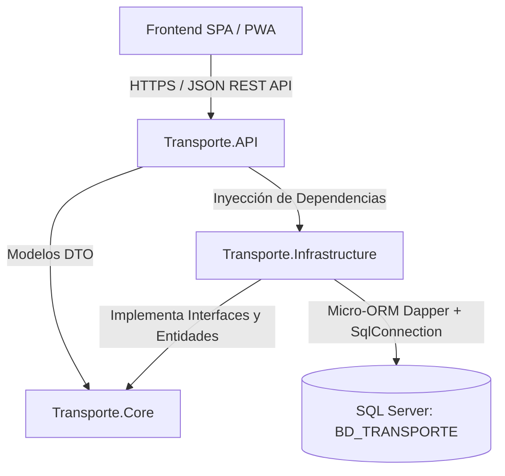
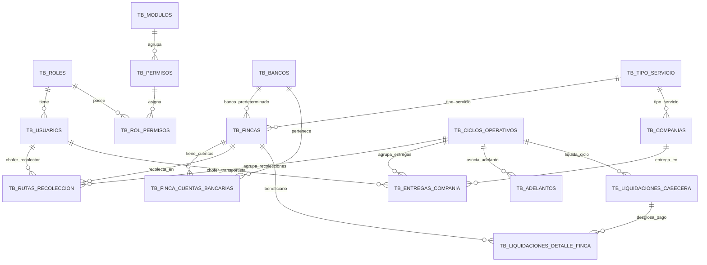

# 🏗️ 01. Arquitectura y Estructura del Sistema (BD_TRANSPORTE)

## 📌 1. Visión General y Propósito del Sistema

El sistema **Transporte y Rutas de Leche** (`BD_TRANSPORTE`) es una solución integral diseñada para la gestión operativa, logística y financiera de la recolección de leche cruda en fincas ganaderas, entrega en plantas procesadoras/queseras receptoras, control y cuadre de mermas por conductor/tanque, y liquidación multimoneda (USD / Bolívares a tasa oficial BCV) a los productores.

---

## 📂 2. Estructura General del Repositorio

A continuación se detalla la jerarquía completa de directorios y el propósito específico de cada uno:

```plaintext
TRANSPORTE/
├── README.md                              # Documentación general y resumen rápido del proyecto
├── Docs/                                  # Documentación técnica, manuales y control de cambios
│   ├── 01_ARQUITECTURA_Y_ESTRUCTURA_SISTEMA.md
│   ├── 02_PROCESOS_OPERATIVOS_Y_LOGICA_NEGOCIO.md
│   └── 03_GUIA_DE_DESARROLLO_VALIDACION_Y_CAMBIOS.md
│
├── Database/                              # Componentes de persistencia y esquemas SQL Server
│   └── Scripts/                           # Scripts de creación, migración y permisos
│       ├── 01_Init_BD_TRANSPORTE.sql      # Creación de base de datos, tablas maestros y relaciones
│       ├── 02_Migrate_Catalogs.sql        # Migración y carga inicial de bancos, fincas y queseras
│       ├── 03_Update_Tipo_Servicio.sql    # Actualizaciones de tipo de servicio (Ruta vs Transporte)
│       ├── 04_Migrate_Historial_BCV_From_Parametros.sql # Migración histórica de tasas BCV (2024 a presente)
│       ├── 05_Clean_And_Assign_Admin_Historial_BCV.sql  # Depuración y asignación de AdminId en CreatedBy
│       ├── 06_Add_Granular_Permissions.sql# Matriz granular de permisos por módulo y rol (RBAC)
│       ├── 07_Add_Audit_Modified_Columns.sql # Auditoría de modificación (ModifiedAt / ModifiedBy)
│       └── 08_Update_Ciclos_Martes_A_Lunes_2026.sql # Normalización semanal Martes a Lunes 2026 (Semana 01 a 53)
│
├── Backend/                               # Solución .NET 8 C# organizada en capas
│   ├── Transporte.sln                     # Archivo de solución Visual Studio
│   └── src/
│       ├── Transporte.Core/               # Capa de Dominio (Entidades de BD y DTOs)
│       │   ├── Entities/Entities.cs       # Modelos de datos POCO fuertemente tipados
│       │   ├── DTOs/DTOs.cs               # Objetos de transferencia para requests y responses
│       │   └── Transporte.Core.csproj     # Configuración del proyecto de Dominio
│       │
│       ├── Transporte.Infrastructure/     # Capa de Acceso a Datos y Seguridad
│       │   ├── Data/
│       │   │   └── SqlConnectionFactory.cs# Factoría de conexiones SqlConnection (IDbConnectionFactory)
│       │   ├── Repositories/
│       │   │   └── Repositories.cs        # Repositorios Dapper (Auth, BCV, Rutas, Catálogos, Ciclos, Entregas)
│       │   ├── Security/
│       │   │   └── SecurityServices.cs    # BCrypt Password Hashing y Servicios de Token JWT
│       │   └── Transporte.Infrastructure.csproj
│       │
│       └── Transporte.API/                # Capa de Exposición Web API RESTful
│           ├── Controllers/               # Controladores de endpoints HTTP
│           │   ├── AuthController.cs      # Autenticación, Login y Perfil (/api/auth)
│           │   ├── BcvController.cs       # Consulta y registro de tasas BCV (/api/bcv)
│           │   ├── CatalogosController.cs # CRUD Fincas, Compañías, Bancos, Choferes (/api/catalogos)
│           │   ├── CiclosController.cs    # Semanas operativas y generación masiva (/api/ciclos)
│           │   ├── RutasController.cs     # Recolección diaria en fincas (/api/rutas)
│           │   └── ReceptoriasController.cs# Entregas a plantas/queseras (/api/receptoria, /api/entregas)
│       │   ├── Transporte.API.csproj      # Configuración del proyecto Web API
│       │   └── wwwroot/                   # Interfaz Web estática sincronizada servida por Kestrel
│       │
│       └── Transporte.Migrador2026/       # Herramienta de consola para migración histórica
│           ├── Program.cs                 # Lógica de migración con reglas de negocio y solo lectura
│           └── Transporte.Migrador2026.csproj
│
├── Ejecutables/                           # Aplicaciones y utilitarios binarios publicados
│   └── Migrador2026.exe                   # Ejecutable standalone de migración histórica 2026
│
├── Frontend/                              # Aplicación Web SPA y PWA (Mobile-Ready)
    ├── index.html                         # Estructura HTML5 de vistas, widgets y modales
    ├── manifest.json                      # Configuración de Progressive Web App (PWA)
    ├── css/
    │   └── app.css                        # Sistema de diseño moderno Dark Mode y Glassmorphism
    ├── js/
    │   └── app.js                         # Lógica cliente, consumo de API, gestión de sesión y estado
    └── assets/, public/, src/             # Recursos estáticos adicionales y expansiones modulares
```

---

## 🏛️ 3. Arquitectura Técnica del Backend (.NET 8 C#)

El backend implementa una **Arquitectura en Capas (Layered / Clean-inspired Architecture)** que separa responsabilidades y garantiza desacoplamiento:



### 3.1. Proyectos del Backend

1. **`Transporte.Core`**:
   - **Independencia absoluta**: No depende de ningún otro proyecto ni paquete de infraestructura externa.
   - Contiene las definiciones de entidades de datos (`Usuario`, `Finca`, `Compania`, `RutaRecoleccion`, `EntregaCompania`, `CicloOperativo`, `HistorialBcv`, etc.).
   - Define los DTOs de entrada y salida para evitar exponer directamente el modelo de base de datos a la API.

2. **`Transporte.Infrastructure`**:
   - Implementa los accesos a datos usando **Dapper** sobre `Microsoft.Data.SqlClient` para máxima velocidad de ejecución y consultas SQL optimizadas.
   - Maneja la conexión a SQL Server a través de `SqlConnectionFactory` con transacciones atómicas.
   - Implementa seguridad criptográfica: `BcryptPasswordService` para contraseñas y `JwtTokenService` para emisión y validación de tokens de sesión.

3. **`Transporte.API`**:
   - Punto de entrada de la aplicación (`Program.cs`).
   - Configura middlewares de:
     - **CORS**: Habilita comunicación fluida entre orígenes.
     - **Autenticación y Autorización**: Esquema `JwtBearer` con validación estricta de clave simétrica, emisor y audiencia.
     - **Swagger/OpenAPI**: Interfaz de pruebas y documentación en `/swagger`.
     - **Servidor de Archivos Estáticos**: Entrega el frontend alojado en `wwwroot` y gestiona el enrutamiento SPA mediante `MapFallbackToFile("index.html")`.

---

## 💾 4. Modelo y Esquema de Base de Datos (`BD_TRANSPORTE`)

La base de datos sigue el estándar de nomenclatura `dbo.TB_*` con llaves foráneas e integridad referencial:



### 4.1. Catálogo de Tablas Principales

| Tabla | Propósito | Columnas Clave |
| :--- | :--- | :--- |
| **`TB_USUARIOS`** | Usuarios del sistema (Admins, Choferes, Receptores). | `Id`, `Username`, `PasswordHash`, `Rol`, `RolId`, `Activo` |
| **`TB_ROLES`** | Catálogo de roles operativos (`ADMIN`, `SUPERVISOR`, `FINANZAS`, `CHOFER`, `RECEPTOR`). | `Id`, `Codigo`, `Nombre`, `Activo` |
| **`TB_MODULOS`** | Módulos funcionales para RBAC. | `Id`, `Codigo`, `Nombre`, `Icono`, `Orden` |
| **`TB_PERMISOS`** | Permisos atómicos (`VER`, `CREAR`, `EDITAR`, `ELIMINAR`, `APROBAR`). | `Id`, `ModuloId`, `Codigo`, `Accion` |
| **`TB_HISTORIAL_BCV`** | Registro histórico de tasas oficiales de cambio USD -> Bs. | `Id`, `Fecha`, `TasaDolarBs`, `Fuente` |
| **`TB_BANCOS`** | Entidades bancarias nacionales para transferencias. | `Id`, `Codigo`, `Nombre`, `Activo` |
| **`TB_FINCAS`** | Fincas productoras con precios por litro (normal y leche ácida) y cuentas. | `Id`, `Codigo`, `Nombre`, `Propietario`, `PrecioLitroUSD`, `PrecioLitroAcidaUSD` |
| **`TB_FINCA_CUENTAS_BANCARIAS`**| Múltiples cuentas bancarias por productor (marcando principal). | `Id`, `FincaId`, `BancoId`, `NumeroCuenta`, `Titular`, `EsPrincipal` |
| **`TB_COMPANIAS`** | Receptorías, plantas queseras y clientes compradores. | `Id`, `Nombre`, `Encargado`, `PrecioCompraLitroUSD` |
| **`TB_CICLOS_OPERATIVOS`** | Semanas operativas de trabajo (ej. Miércoles a Martes). | `Id`, `Codigo`, `FechaInicio`, `FechaFin`, `Estado` |
| **`TB_RUTAS_RECOLECCION`** | Registro de litros recogidos en fincas por chofer/fecha (con estado de leche ácida y precio aplicado). | `Id`, `CicloId`, `FincaId`, `UsuarioId`, `Litros`, `EsAcida`, `PrecioLitroUSDAplicado`, `SubtotalUSD`, `SubtotalBs`, `CreatedBy`, `ModifiedAt`, `ModifiedBy` |
| **`TB_ENTREGAS_COMPANIA`** | Registro de leche entregada y descargada en receptorías. | `Id`, `CicloId`, `CompaniaId`, `UsuarioId`, `Litros`, `SubtotalUSD`, `SubtotalBs`, `CreatedBy`, `ModifiedAt`, `ModifiedBy` |
| **`TB_ADELANTOS`** | Anticipos de dinero en USD o Bs otorgados a fincas o receptorías. | `Id`, `TipoBeneficiario`, `BeneficiarioId`, `Moneda`, `MontoOriginal`, `MontoEnBs` |
| **`TB_LIQUIDACIONES_CABECERA`** | Resumen financiero consolidado del ciclo semanal. | `Id`, `CicloId`, `TotalLitrosGeneral`, `TotalMontoUSD`, `TotalNetoAPagarBs` |
| **`TB_LIQUIDACIONES_DETALLE_FINCA`**| Desglose neto por productor, banco y número de cuenta. | `Id`, `LiquidacionId`, `FincaId`, `TotalLitros`, `NetoPagarBs`, `EstadoPago` |

---

## 🎨 5. Arquitectura del Frontend (SPA + PWA)

La interfaz de usuario está desarrollada en **HTML5, CSS3 moderno y Vanilla JavaScript modular**:

1. **Diseño Visual**:
   - Paleta cromática profunda `Dark Theme` (fondo `#090d16`, paneles `#131b2e` con bordes `#1e293b`).
   - Efectos `Glassmorphism` con `backdrop-filter: blur(12px)`.
   - Tipografía moderna: **Outfit** (titulares y widgets) e **Inter** (cuerpo, tablas y formularios).
2. **Capacidades PWA**:
   - Configurado con `manifest.json` para instalación como aplicación nativa en dispositivos móviles de choferes.
3. **Gestión de Estado y Sesión**:
   - Almacenamiento seguro del Token JWT en `localStorage`.
   - Temporizador configurable de inactividad con cierre automático de sesión.
   - Decodificación y verificación de roles en el cliente para ocultar/mostrar secciones según permisos.
