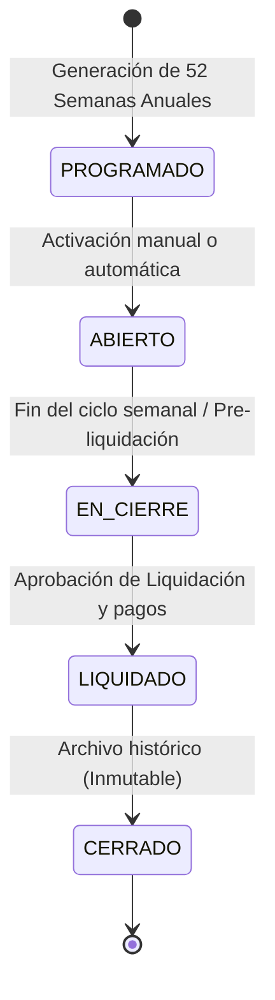
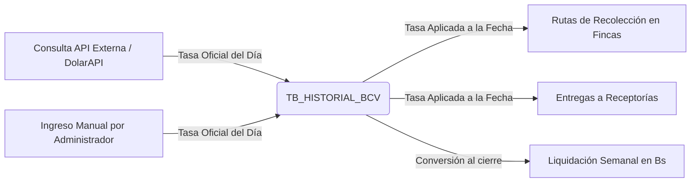
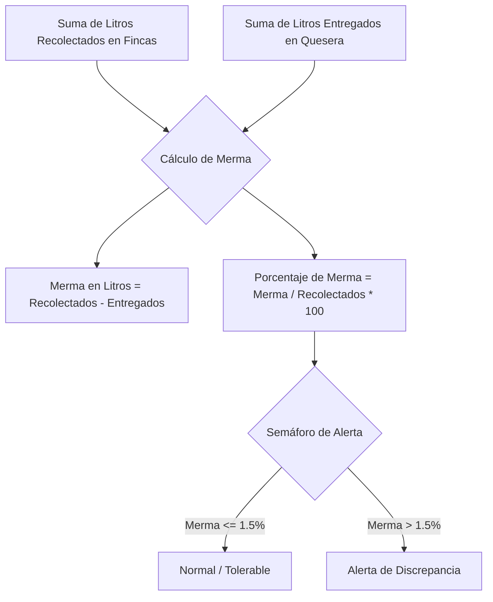
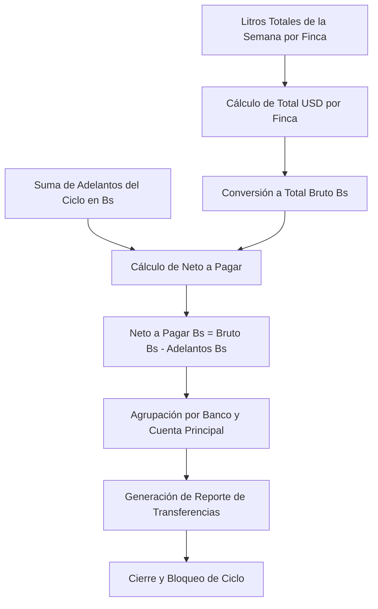

# 🔄 02. Procesos Operativos y Lógica de Negocio (BD_TRANSPORTE)

Este documento describe el flujo funcional, las reglas de negocio, fórmulas matemáticas y ciclo de vida de los datos en el sistema **Rutas de Leche y Liquidación Multimoneda**.

---

## 📅 1. Ciclo de Vida de la Semana Operativa (`TB_CICLOS_OPERATIVOS`)

El negocio opera por **Semanas Operativas** continuas (comúnmente configuradas de miércoles a martes o de lunes a domingo según el esquema comercial).

### Reglas del Ciclo:
1. **Calendario Operativo Oficial (Martes a Lunes)**: Cada semana de trabajo inicia un **Martes** y concluye el siguiente **Lunes** (7 días continuos).
   - **Semana 01**: Martes 30/12/2025 al Lunes 05/01/2026.
   - **Semana 02**: Martes 06/01/2026 al Lunes 12/01/2026.
   - **Semana 03**: Martes 13/01/2026 al Lunes 19/01/2026.
   - ... y así sucesivamente para las 53 semanas del año.
2. **Unicidad de Semana Activa**: Solo puede existir **una** semana con estado `ABIERTO` a la vez (correspondiente a la semana en curso). Al pasar de semana, el ciclo anterior pasa a `CERRADO` o `EN_CIERRE`.
3. **Asignación Automática de Operaciones**: Cada recolección en finca (`TB_RUTAS_RECOLECCION`) y cada entrega a quesera (`TB_ENTREGAS_COMPANIA`) se vincula de manera exacta a su `CicloId` según su campo `Fecha` (`Fecha BETWEEN FechaInicio AND FechaFin`).

---

## 💵 2. Manejo Cambiario Multimoneda y Tasas BCV

Dado el entorno bimoneda (USD / Bs), la fijación del precio y la liquidación requieren un control estricto de la tasa oficial del **Banco Central de Venezuela (BCV)**.

### Reglas de Conversión:
1. **Tasa de la Fecha**: Cada recolección guarda de manera inmutable la `TasaDolarBsAplicada` correspondiente a la fecha del registro.
2. **Fallback de Tasa**: Si no se ha cargado la tasa del día actual, el sistema utiliza la última tasa registrada en `TB_HISTORIAL_BCV`.
3. **Cálculo de Totales por Registro**:
   $$\text{Subtotal USD} = \text{Litros} \times \text{PrecioLitroUSD}$$
   $$\text{Subtotal Bs} = \text{Subtotal USD} \times \text{TasaDolarBsAplicada}$$

---

## 🚚 3. Proceso Diario de Recolección en Campo (Rutas de Fincas)

1. **Captura en Finca**: El chofer llega a la finca productora y registra los litros ordeñados.
2. **Precios Diferenciados y Leche Ácida**: Cada finca posee un precio normal pactado por litro (`PrecioLitroUSD`) y un precio especial para leche ácida (`PrecioLitroAcidaUSD`). Al registrar la recolección, si la leche sale ácida (`EsAcida = 1`), el sistema aplica automáticamente `PrecioLitroAcidaUSD` (o el precio acordado para dicho ticket), afectando de forma transparente los subtotales de la finca en liquidaciones.
3. **Validación de Roles y Edición**:
   - **Rol `CHOFER`**: Solo puede visualizar y modificar recolecciones registradas por él mismo correspondientes al **día en curso**.
   - **Rol `ADMIN` / `SUPERVISOR`**: Puede visualizar todas las rutas, filtrar por conductor/finca y realizar correcciones históricas o asignar la recolección a cualquier conductor.

---

## 🏭 4. Proceso de Entrega y Descarga en Receptoría / Quesera

1. **Llegada a Planta**: El conductor traslada la carga total del tanque a la receptoría o planta quesera.
2. **Medición y Registro**: Se registran los litros netos recibidos en planta (`TB_ENTREGAS_COMPANIA`).
3. **Precio de Venta**: La compañía tiene asignado un precio de compra acordado (`PrecioCompraLitroUSD`) que determina el valor de venta del lote.

---

## ⚖️ 5. Cuadre Diario y Balance de Mermas

Uno de los controles críticos del sistema es la detección de pérdidas de leche en tránsito (por evaporación, calibración de varillas o discrepancias de pesaje).

### Fórmulas del Balance:
$$\text{Merma (Litros)} = \sum \text{Litros Fincas (Chofer, Fecha)} - \sum \text{Litros Receptoría (Chofer, Fecha)}$$

$$\% \text{Merma} = \left( \frac{\text{Merma (Litros)}}{\sum \text{Litros Fincas}} \right) \times 100$$

*El sistema calcula este balance en tiempo real por conductor y fecha en la pantalla de **Balance de Mermas**.*

---

## 💰 6. Gestión de Adelantos Bimoneda (`TB_ADELANTOS`)

Los productores y receptorías pueden solicitar anticipos de dinero a lo largo del ciclo semanal.

1. **Beneficiarios**:
   - `FINCA`: Se deducirá del monto neto a pagar en la liquidación semanal del productor.
   - `RECEPTORIA`: Se concilia contra las cuentas por cobrar a la planta quesera.
2. **Moneda del Adelanto**:
   - Si el adelanto es en **Bs**: $\text{MontoEnBs} = \text{MontoOriginal}$
   - Si el adelanto es en **USD**: $\text{MontoEnBs} = \text{MontoOriginal} \times \text{TasaCambioFecha}$
3. **Estado del Adelanto**: `PENDIENTE` hasta que se procesa la liquidación semanal, momento en el cual pasa a `LIQUIDADO` y queda asociado al `CicloLiquidadoId`.

---

## 📑 7. Pre-Liquidación y Liquidación Semanal Consolidada

Al concluir el ciclo operativo, el área de administración/finanzas ejecuta el cierre de liquidación:

### Algoritmo de Liquidación por Finca:
1. $\text{TotalLitros} = \sum_{\text{ciclo}} \text{Litros Recolectados}$
2. $\text{TotalMontoUSD} = \sum_{\text{ciclo}} (\text{Litros} \times \text{PrecioLitroUSD})$
3. $\text{TotalBrutoBs} = \sum_{\text{ciclo}} \text{SubtotalBs}$
4. $\text{TotalAdelantosBs} = \sum_{\text{ciclo}} \text{MontoEnBs (Adelantos Finca)}$
5. $\text{NetoPagarBs} = \text{TotalBrutoBs} - \text{TotalAdelantosBs}$

### Destino de Pagos:
El sistema consulta la tabla `TB_FINCA_CUENTAS_BANCARIAS` para asociar automáticamente el pago a la **Cuenta Bancaria Principal** del productor (`EsPrincipal = 1`), especificando el banco nacional destino y el número de cuenta de 20 dígitos.

---

## 🔒 8. Matriz de Roles y Permisos (RBAC)

| Módulo / Acción | ADMIN | SUPERVISOR | FINANZAS | CHOFER | RECEPTOR |
| :--- | :---: | :---: | :---: | :---: | :---: |
| **Dashboard y Métricas** | ✅ Total | ✅ Total | ✅ Total | ✅ Solo Propias | ✅ Solo Entregas |
| **Rutas (Recolección)** | ✅ Ver/Crear/Editar/Borrar | ✅ Ver/Crear/Editar | 👁️ Solo Ver | ✏️ Propias (Día actual) | ❌ |
| **Receptorías (Entregas)** | ✅ Ver/Crear/Editar/Borrar | ✅ Ver/Crear/Editar | 👁️ Solo Ver | ✏️ Propias (Día actual) | ✏️ Registrar recepción |
| **Catálogo Fincas/Compañías**| ✅ CRUD Completo | 👁️ Solo Ver | 👁️ Solo Ver | ❌ | ❌ |
| **Catálogo Bancos** | ✅ CRUD Completo | 👁️ Solo Ver | 👁️ Solo Ver | ❌ | ❌ |
| **Historial y Registro BCV** | ✅ CRUD Completo | 👁️ Solo Ver | ✅ Registrar Tasa | 👁️ Solo Ver hoy | 👁️ Solo Ver hoy |
| **Semanas Operativas** | ✅ Generar/Activar/Cerrar | 👁️ Solo Ver | 👁️ Solo Ver | ❌ | ❌ |
| **Balance de Mermas** | ✅ Todos los choferes | ✅ Todos los choferes | 👁️ Solo Ver | 👁️ Solo su merma | 👁️ Solo su merma |
| **Liquidación Semanal** | ✅ Procesar/Aprobar | 👁️ Preliquidación | ✅ Procesar/Exportar | ❌ | ❌ |
| **Adelantos** | ✅ CRUD Completo | 👁️ Solo Ver | ✅ Registrar/Aprobar | ❌ | ❌ |
