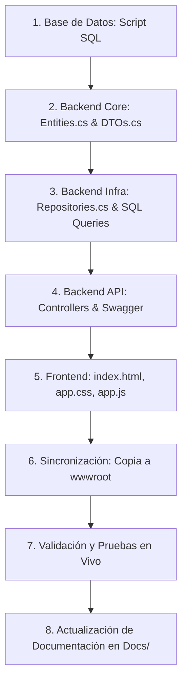

# 🛠️ 03. Guía de Desarrollo, Validación de Cambios y Control de Calidad (BD_TRANSPORTE)

Este documento es de consulta **obligatoria** antes, durante y después de realizar modificaciones en el código fuente, la base de datos o la interfaz de usuario. Establece los estándares de calidad, el flujo de desarrollo y el protocolo de verificación cruzada para asegurar la integridad de la plataforma.

---

## 🛑 REGLA FUNDAMENTAL DE AMBIENTES (DEV vs PROD)

> [!IMPORTANT]
> 1. **TODOS los cambios de código, nuevas características, pruebas y ajustes de base de datos se ejecutan SIEMPRE en DESARROLLO (DEV)**:
>    - Base de Datos activa: `BD_TRANSPORTE_DEV`
>    - Puerto API / App: `http://localhost:5188/`
> 2. **PRODUCCIÓN (`BD_TRANSPORTE_PROD` / Puerto `5190`) permanece INTACTO e INMUTABLE** durante el desarrollo activo.
> 3. **Pase a Producción**: Únicamente se actualiza Producción al ejecutar un **DESPLIEGUE FORMAL** mediante [`desplegar.bat`](file:///c:/Users/Usuario/source/repos/Transporte_V2/desplegar.bat) o `powershell -ExecutionPolicy Bypass -File .\desplegar.ps1`.

---

## 🧭 1. Protocolo de Validación Cruzada ante Cambios

Cada vez que se introduzca un nuevo requerimiento, campo o modificación funcional, se debe seguir la siguiente **cadena de impacto y actualización**:



---

## 📋 2. Matriz de Impacto por Tipo de Cambio

| Si vas a modificar... | Archivos que OBLIGATORIAMENTE debes revisar y actualizar |
| :--- | :--- |
| **Nueva tabla o columna en la Base de Datos** | 1. `Database/Scripts/*.sql` (script de creación o migración incremental).<br>2. [Entities.cs](file:///c:/Users/Usuario/source/repos/Transporte/Backend/src/Transporte.Core/Entities/Entities.cs) (mapeo POCO de la entidad).<br>3. [DTOs.cs](file:///c:/Users/Usuario/source/repos/Transporte/Backend/src/Transporte.Core/DTOs/DTOs.cs) (DTOs de creación, edición y respuesta).<br>4. [Repositories.cs](file:///c:/Users/Usuario/source/repos/Transporte/Backend/src/Transporte.Infrastructure/Repositories/Repositories.cs) (consultas SQL con Dapper).<br>5. [Controllers/*.cs](file:///c:/Users/Usuario/source/repos/Transporte/Backend/src/Transporte.API/Controllers/) (endpoints expuestos).<br>6. [Frontend/index.html](file:///c:/Users/Usuario/source/repos/Transporte/Frontend/index.html) y [Frontend/js/app.js](file:///c:/Users/Usuario/source/repos/Transporte/Frontend/js/app.js).<br>7. [01_ARQUITECTURA_Y_ESTRUCTURA_SISTEMA.md](file:///c:/Users/Usuario/source/repos/Transporte/Docs/01_ARQUITECTURA_Y_ESTRUCTURA_SISTEMA.md) (diccionario de datos). |
| **Nuevo Endpoint o regla de negocio en Backend** | 1. [DTOs.cs](file:///c:/Users/Usuario/source/repos/Transporte/Backend/src/Transporte.Core/DTOs/DTOs.cs) (definición de tipos de request/response).<br>2. [Repositories.cs](file:///c:/Users/Usuario/source/repos/Transporte/Backend/src/Transporte.Infrastructure/Repositories/Repositories.cs) (método de repositorio e interfaz).<br>3. [Controllers/*.cs](file:///c:/Users/Usuario/source/repos/Transporte/Backend/src/Transporte.API/Controllers/) (acción en el controlador con atributos `[Authorize]`).<br>4. [Program.cs](file:///c:/Users/Usuario/source/repos/Transporte/Backend/src/Transporte.API/Program.cs) (registro en el contenedor DI si es un nuevo servicio/repositorio).<br>5. [02_PROCESOS_OPERATIVOS_Y_LOGICA_NEGOCIO.md](file:///c:/Users/Usuario/source/repos/Transporte/Docs/02_PROCESOS_OPERATIVOS_Y_LOGICA_NEGOCIO.md). |
| **Cambios en la Interfaz de Usuario (UI/UX)** | 1. [Frontend/index.html](file:///c:/Users/Usuario/source/repos/Transporte/Frontend/index.html) (estructura DOM y modales).<br>2. [Frontend/css/app.css](file:///c:/Users/Usuario/source/repos/Transporte/Frontend/css/app.css) (estilos y responsividad).<br>3. [Frontend/js/app.js](file:///c:/Users/Usuario/source/repos/Transporte/Frontend/js/app.js) (event listeners, consumo fetch y validaciones).<br>4. **Sincronizar** archivos hacia `Backend/src/Transporte.API/wwwroot/`. |
| **Permisos o Roles de Usuario** | 1. [06_Add_Granular_Permissions.sql](file:///c:/Users/Usuario/source/repos/Transporte/Database/Scripts/06_Add_Granular_Permissions.sql).<br>2. [Repositories.cs (AuthRepository)](file:///c:/Users/Usuario/source/repos/Transporte/Backend/src/Transporte.Infrastructure/Repositories/Repositories.cs).<br>3. [Controllers/*.cs](file:///c:/Users/Usuario/source/repos/Transporte/Backend/src/Transporte.API/Controllers/) (roles en `[Authorize(Roles = "...")]`).<br>4. [Frontend/js/app.js](file:///c:/Users/Usuario/source/repos/Transporte/Frontend/js/app.js) (funciones de visibilidad de menú y botones según rol). |

---

## ⚡ 3. Guía de Ejecución y Pruebas Locales

### 3.1. Base de Datos (SQL Server)
1. Abrir **SQL Server Management Studio (SSMS)** o Azure Data Studio.
2. Ejecutar secuencialmente los scripts dentro de `Database/Scripts/`:
   - `01_Init_BD_TRANSPORTE.sql`
   - `02_Migrate_Catalogs.sql`
   - `03_Update_Tipo_Servicio.sql`
   - `06_Add_Granular_Permissions.sql`
3. Verificar que la base de datos `BD_TRANSPORTE` contenga todas las tablas `TB_*` y datos iniciales.

### 3.2. Configuración de Cadena de Conexión
Verificar en `Backend/src/Transporte.API/appsettings.json`:
```json
{
  "ConnectionStrings": {
    "DefaultConnection": "Server=localhost;Database=BD_TRANSPORTE;Trusted_Connection=True;TrustServerCertificate=True;"
  }
}
```

### 3.3. Compilación y Ejecución del Backend
Desde una terminal PowerShell en el directorio `Backend/src/Transporte.API`:
```powershell
# Restaurar paquetes NuGet y compilar
dotnet restore
dotnet build

# Ejecutar el servidor API en modo desarrollo
dotnet run
```
- **Documentación Swagger**: `https://localhost:7196/swagger` (o `http://localhost:5000/swagger`).
- **Aplicación Web**: `https://localhost:7196/` (servida directamente desde `wwwroot`).

---

## 🔄 4. Proceso de Sincronización Frontend <-> Backend

Dado que el backend de ASP.NET Core está configurado para servir la aplicación cliente desde `Transporte.API/wwwroot/`, cualquier cambio realizado en la carpeta `Frontend/` debe copiarse a `wwwroot`:

```powershell
# Comando PowerShell para sincronizar cambios de Frontend a wwwroot
Copy-Item -Path "Frontend\*" -Destination "Backend\src\Transporte.API\wwwroot\" -Recurse -Force
```

> [!IMPORTANT]
> Nunca modificar directamente solo `wwwroot` sin reflejar los cambios en `Frontend/`, ya que `Frontend/` es el repositorio fuente del código cliente.

---

## ✅ 5. Checklist Obligatorio de Verificación Pre-Despliegue

Antes de dar por completada una tarea o cambio, verifique los siguientes puntos:

- [ ] **Controladores y Swagger**: ¿Todos los métodos públicos en los Controllers tienen un verbo HTTP explícito (`[HttpGet]`, `[HttpPost]`, `[HttpPut]`, `[HttpDelete]`) y decoradores de parámetros (`[FromRoute]`, `[FromBody]`, `[FromQuery]`)? ¿Carga `/swagger/v1/swagger.json` sin error 500?
- [ ] **Base de Datos**: ¿Las tablas nuevas o modificadas tienen llave primaria, índices foráneos y valores por defecto adecuados?
- [ ] **DTOs y Tipado**: ¿Los DTOs en C# coinciden con los tipos esperados en TypeScript/JavaScript?
- [ ] **Manejo de Errores**: ¿Los endpoints devuelven códigos HTTP apropiados (`200 OK`, `400 BadRequest`, `401 Unauthorized`, `404 NotFound`, `500 Error`) con mensajes claros?
- [ ] **Seguridad y Roles**: ¿Se agregaron las anotaciones `[Authorize]` y `[Authorize(Roles = "...")]` en los controladores sensibles?
- [ ] **Multimoneda**: ¿Las transacciones que involucran montos calculan y guardan tanto el subtotal en USD como en Bs con la tasa BCV correspondiente?
- [ ] **UI Responsiva**: ¿La pantalla y sus modales se visualizan correctamente en pantallas móviles y de escritorio?
- [ ] **Sincronización `wwwroot`**: ¿Se sincronizaron los archivos de `Frontend/` a `Backend/src/Transporte.API/wwwroot/`?
- [ ] **Actualización Documental**: ¿Se actualizaron los documentos en `Docs/` con las nuevas tablas, campos o reglas agregadas?

---

## 🛡️ 6. Reglas de Oro para Controladores y Prevención de Errores en Swagger (HTTP 500)

Para evitar caídas del generador de esquemas OpenAPI / Swagger (`Failed to load API definition - 500 /swagger/v1/swagger.json`), se deben respetar **sin excepción** las siguientes directrices al crear o modificar controladores:

1. **Verbo HTTP Obligatorio**:
   * Todo método público dentro de una clase decorada con `[ApiController]` **DEBE** tener un atributo de verbo HTTP explícito (`[HttpGet]`, `[HttpPost]`, `[HttpPut]`, `[HttpDelete]`, etc.).
   * Si un método auxiliar en el controlador es público y no representa un endpoint, debe decorarse con `[NonAction]`, o preferiblemente ser `private` o `protected`.

2. **Cero Atributos Huérfanos o Duplicados**:
   * Nunca dejar un atributo `[HttpGet]` suelto o colocado inmediatamente sobre otro `[HttpGet("ruta")]`. Cada método debe tener una única definición clara de ruta y verbo.

3. **Decoradores Explícitos de Parámetros**:
   * Rutas con identificador (`"{id}"`): Usar `[FromRoute] int id`.
   * Cargas útiles JSON: Usar `[FromBody] MiDto dto`.
   * Parámetros en QueryString: Usar `[FromQuery] string filtro`.

4. **Configuración de Resiliencia en `Program.cs`**:
   * En `builder.Services.AddSwaggerGen(...)`, mantener siempre activos los resolvedores de conflicto:
     ```csharp
     c.ResolveConflictingActions(apiDescriptions => apiDescriptions.First());
     c.CustomSchemaIds(type => type.FullName ?? type.Name);
     ```

